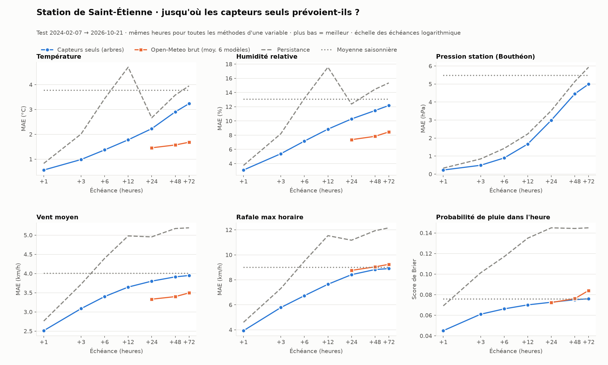

# Weather Intelligence — Metseo

Local weather forecasting for **Saint-Étienne (France)**, built around a planned weather station at Télécom Saint-Étienne.

The project learns from Météo-France hourly observations and archived numerical weather prediction (NWP) forecasts. It answers two questions:

1. **How much can a local model correct global weather forecasts for wind at +24 / +48 / +72 h?**
2. **How far ahead can the station's own sensors forecast each variable they measure?** The sensors are SHT30 (temperature, humidity), BMP280 (pressure), an anemometer with a vane (wind, direction, gusts) and a tipping-bucket rain gauge.

Every experiment follows a protocol written before training. Each final model is chosen on validation data and scored once on a held-out test period. Negative results are kept.

---

## Key results

### 1. Multi-source wind correction: the main result

Test: **5,652 shared target hours, 8 February to 21 October 2026**. No earlier study had used this period. Errors are MAE in km/h ([full report](reports/wind_multisource/RAPPORT.md), in French).

| Lead time | Raw NWP (mean of 6 models) | A · station + 4 NWP models | B · + 6 models × 10 variables | C · + neighbouring stations |
| --- | ---: | ---: | ---: | ---: |
| +24 h | 3.22 | 2.72 | 2.68 | **2.66** |
| +48 h | 3.25 | 2.81 | **2.76** | 2.77 |
| +72 h | 3.35 | 2.97 | **2.93** | 2.93 |

- **The local correction holds across seasons.** It improves on raw NWP by **17.1 / 15.0 / 12.6 %** MAE. Weekly-block bootstrap intervals exclude zero.
- **More NWP models and variables help a little, consistently:** B has 1.5–1.7 % lower MAE than A at every lead time.
- **Neighbouring stations add almost nothing** beyond +24 h.
- **80 % intervals are well calibrated:** measured coverage is 81–82 %.
- **Strong winds are still underestimated:** the bias is −5 to −7 km/h above the 90th percentile.


### 2. Sensor-only forecasting horizons

One gradient-boosted model is trained per variable and lead time, using **only the variables the station will measure**. It learns from the SAINT-ETIENNE record from 2000 onwards and is tested from February 2024 to October 2026 ([metrics](reports/sensor_horizons/metrics.json)). MAE, except rain, which uses the Brier score:

| Variable | +1 h | +6 h | +24 h | +72 h | Raw NWP at +24 h |
| --- | ---: | ---: | ---: | ---: | ---: |
| Wind speed (km/h) | 2.51 | 3.40 | 3.80 | 3.95 | 3.33 |
| Gusts (km/h) | 3.93 | 6.73 | 8.41 | 8.90 | 8.76 |
| Temperature (°C) | 0.56 | 1.37 | 2.23 | 3.24 | 1.46 |
| Humidity (%) | 3.09 | 7.16 | 10.28 | 12.17 | 7.37 |
| Pressure (hPa) | 0.22 | 0.89 | 2.99 | 4.99 | — |
| Rain in the hour (Brier) | 0.045 | 0.066 | 0.073 | 0.076 | 0.072 |

**Sensors alone are excellent at very short range and beat persistence at every lead time.** From about +24 h, raw NWP forecasts become better for temperature, humidity and wind. Past that point, a local station needs NWP inputs.



### 3. Earlier studies

| Study | Result | Report |
| --- | --- | --- |
| Frozen tree baseline, winter 2026 (748 h) | MAE 2.76 / 3.08 / 3.11 km/h at +24 / 48 / 72 h | [wind_advanced](reports/wind_advanced/RAPPORT.md) |
| BiGRU / BiLSTM / attention networks | The best network, a BiLSTM, **does not beat** the tree baseline (2.86 / 3.22 / 3.30) | [wind_neural](reports/wind_neural/RAPPORT.md) |
| Station-only wind, +1 to +24 h (2025) | Direct boosted trees against persistence and the seasonal mean | [wind_24h](reports/wind_24h/REPORT.md) |
| Original +1 h BiGRU | MAE 2.670 km/h, persistence 2.699: a marginal gain | [checkpoints/metrics.json](checkpoints/metrics.json) |

The winter 2026 figures are **not comparable** with the multi-source test: the periods and wind regimes differ.

---

## Repository layout

```text
analysis/
  fetch_meteofrance.py           Download Météo-France hourly exports (data.gouv.fr) with SHA-256 provenance
  fetch_nwp_archive.py           Archived NWP forecasts from the Open-Meteo Previous Runs API
  fetch_gefs.py                  NOAA GEFS v12 reforecast / operational control runs (byte-range GRIB)
  build_station_dataset.py       Compact multi-station dataset of the station's sensor variables
  benchmark_wind_multisource.py  Multi-source wind benchmark (select / evaluate phases)
  sensor_horizon_study.py        Sensor-only forecasts of every variable, +1 to +72 h
  station_network.py             Sensor-only model learned on the Météo-France network (in progress)
  train_wind_advanced.py         Frozen tree baseline at +24 / +48 / +72 h
  train_wind_neural.py           BiGRU / BiLSTM / attention selection, refit, evaluation, replay
  neural_data.py, neural_models.py
  plot_*.py                      Charts computed from committed results only
reports/                         Protocols, reports, metrics, frozen predictions and charts
tests/                           Causality, leakage, model and pipeline checks
import_data.py, dataset.py,
model.py, train.py               Original +1 h BiGRU pipeline (kept for reference)
```

Reports are written in French. Code, comments and charts are in English.

---

## Setup

Python **3.11+** (tested with 3.12).

```bash
python3.12 -m venv .venv
source .venv/bin/activate
python -m pip install --upgrade pip
python -m pip install -r requirements-wind.txt      # tree models and benchmarks
```

For the neural experiments, also install PyTorch for your platform, then the neural requirements:

```bash
python -m pip install torch==2.8.0 --index-url https://download.pytorch.org/whl/cu126   # or .../whl/cpu
python -m pip install -r requirements-neural.txt
```

Do not share one virtual environment between Windows and Linux.

## Data

Raw data is **not versioned**. It is downloaded into `data/`, which Git ignores:

```bash
python analysis/fetch_meteofrance.py        # departments 42, 69, 43, 63
python analysis/fetch_nwp_archive.py --start 2024-01-01 --end 2026-10-21 --horizons 48 72 96 \
  --models ecmwf_ifs025 icon_global icon_eu gfs_global gem_global jma_seamless \
  --variables wind_speed_10m wind_direction_10m temperature_2m surface_pressure wind_gusts_10m \
              wind_speed_100m pressure_msl relative_humidity_2m cloud_cover precipitation \
  --output-dir data/nwp_multisource
```

Input fingerprints are recorded in each `metrics.json`. Météo-France's "latest" export grows every day, so refreshing it changes the inputs.

## Reproducing the experiments

```bash
# Multi-source wind benchmark (~45 min selection + ~10 min evaluation on 4 CPU threads)
python analysis/benchmark_wind_multisource.py --phase select
python analysis/benchmark_wind_multisource.py --phase evaluate
python analysis/plot_wind_multisource.py

# Sensor-only horizons
python analysis/sensor_horizon_study.py
python analysis/plot_sensor_horizons.py

# Tests
python -m unittest discover -s tests -v
```

The `evaluate` phase refuses to run if the protocol or the script changed after `selection.json` was written. For the earlier baselines and neural networks, see the commands in their reports.

---

## Limitations

- **Short NWP history.** The Open-Meteo Previous Runs archive starts in January 2024, which leaves about two years of training for NWP-correcting models.
- **Publication delays are approximated.** Archive offsets follow model initialisation time, with a conservative 24 h margin. Historical outages are not reconstructed.
- **Point forecasts only.** Each model gives one grid point, with no neighbouring cells, and AROME / ARPEGE archives are empty.
- **Not the future station's sensors.** Models learn from Météo-France instruments and siting, so the Télécom station will need calibration. Pressure comes from Bouthéon, 13 km away.
- **No live service yet.** The models replay historical issue times; they do not fetch current observations.

## Roadmap

1. Extend the NWP history with the NOAA GEFS reforecast (`fetch_gefs.py`).
2. Correct strong-wind underestimation with quantile losses or validated weighting.
3. Learn sensor-only models on the whole Météo-France network ([protocol](reports/station_network/PROTOCOLE.md)), then re-evaluate neural networks on the same split.
4. Connect the Télécom Saint-Étienne station and serve live forecasts.

## Data sources

- Météo-France, *Données climatologiques de base — horaires*, via [data.gouv.fr](https://www.data.gouv.fr/)
- [Open-Meteo Previous Runs API](https://open-meteo.com/en/docs/previous-runs-api)
- NOAA GEFS v12 on AWS Open Data (`noaa-gefs-retrospective`, `noaa-gefs-pds`)
