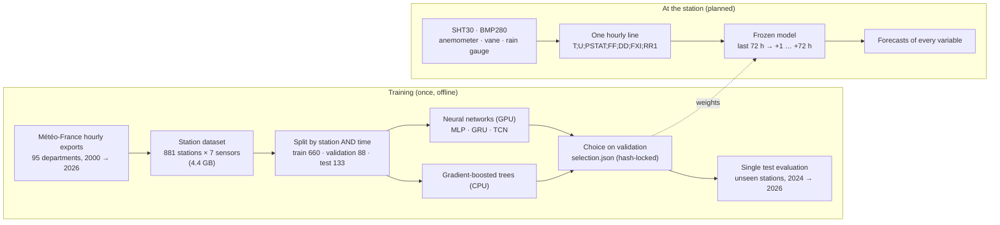
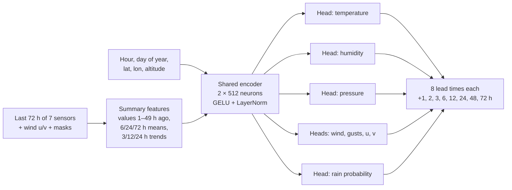
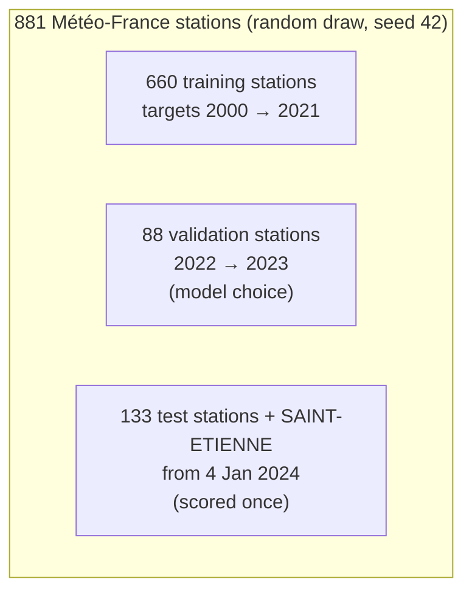
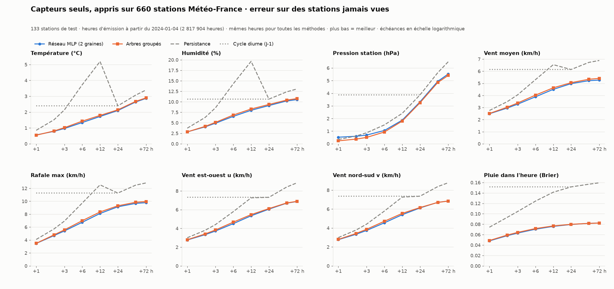

# Weather Intelligence — Metseo

Local weather forecasting for the weather station of **Télécom Saint-Étienne (France)**.

The station will measure temperature and humidity (SHT30), pressure (BMP280), wind speed, direction and gusts (anemometer and vane) and rain (tipping-bucket gauge). The project builds models that **forecast all of these variables from +1 to +72 h using only the station's own sensors**. The models learn from 26 years of the same measurements at hundreds of Météo-France stations.

Every experiment follows a protocol written before training. Models are chosen on validation data and scored once on held-out stations and years. Negative results are kept.

---

## Latest news (November 2026)

- **The sensor-only model is trained and tested on the whole Météo-France network.** It uses 881 stations and 2000–2026 data, with a neural network trained on an RTX A5000 (24 GB) and gradient-boosted trees on the CPU ([report](reports/station_network/RAPPORT.md), in French).
- **It works on stations it has never seen.** Test errors on 133 unseen stations match those on the 660 training stations, which is the situation of the future Télécom station.
- **The network (an MLP) and the trees are almost tied.** The network wins 52 of 64 variable × lead-time cells by 1–5 % (50 significantly); the trees win clearly on pressure. 95 % block-bootstrap intervals are in [bootstrap.json](reports/station_network/bootstrap.json).
- **A data-format sheet** tells the Arduino and server team exactly what the model expects every hour ([docs/FORMAT_DONNEES_STATION.md](docs/FORMAT_DONNEES_STATION.md)).

---

## How it works



**"Sensor-only"** means the model's inputs are only:
- the station's last 72 hours of the 7 measurements, with a mask for missing values;
- the hour and day of the year;
- the station's latitude, longitude and altitude.

It uses no weather forecast from the internet, no satellite and no neighbouring station, so the station can forecast offline. Météo-France data is used only to learn how weather evolves from these measurements.

### The selected network



- **Size and training:** about 1.4 million parameters, trained with a Huber loss on standardised targets plus a cross-entropy for rain.
- **Prediction:** the average of two runs with different seeds.
- **Candidates:** three architectures were trained; the simplest won, by a small margin (validation score, 1 = persistence, lower is better):

| Network | How it reads the 72 h window | Validation score |
| --- | --- | ---: |
| **MLP (selected)** | Summary features | **0.748** |
| GRU (2 layers × 256) | Hour by hour, recurrent | 0.752 |
| TCN (6 dilated convolutions) | Hour by hour, convolutional | 0.777 |
| *Gradient-boosted trees, for comparison* | *129 summary features* | *0.733* |

### How the data is split



Test stations and years are never used for training or for choosing a model. This simulates a new station installed somewhere the model has never seen.

---

## Key results

### 1. Sensor-only model learned on the Météo-France network: the core result

**Test set:**
- 133 unseen stations;
- issue times from 4 January 2024 to October 2026;
- 2.8 million issue times, the same hours for every method.

MAE, or the Brier score for rain; lower is better ([full report](reports/station_network/RAPPORT.md)):

| Variable | Method | +1 h | +3 h | +6 h | +12 h | +24 h | +72 h |
| --- | --- | ---: | ---: | ---: | ---: | ---: | ---: |
| Temperature (°C) | Network | 0.56 | **0.97** | **1.34** | **1.72** | **2.10** | **2.87** |
| | Trees | **0.54** | 1.02 | 1.43 | 1.79 | 2.14 | 2.90 |
| | Persistence | 0.85 | 2.14 | 3.73 | 5.19 | 2.40 | 3.40 |
| Humidity (%) | Network | **2.8** | **4.9** | **6.5** | **8.0** | **9.1** | **10.5** |
| | Persistence | 3.7 | 8.6 | 14.3 | 19.6 | 10.6 | 13.1 |
| Pressure (hPa) | Network | 0.52 | 0.69 | 1.05 | 1.87 | 3.32 | 5.52 |
| | Trees | **0.23** | **0.50** | **0.93** | **1.80** | **3.25** | **5.41** |
| | Persistence | 0.34 | 0.87 | 1.49 | 2.41 | 3.87 | 6.49 |
| Wind (km/h) | Network | **2.5** | **3.3** | **3.9** | **4.5** | **5.0** | **5.3** |
| | Persistence | 2.8 | 4.0 | 5.3 | 6.5 | 6.1 | 6.9 |
| Gusts (km/h) | Network | **3.5** | **5.4** | **6.7** | **8.1** | **9.1** | **9.8** |
| | Persistence | 4.1 | 6.9 | 9.7 | 12.5 | 11.3 | 12.8 |
| Rain in the hour (Brier) | Network | **0.048** | **0.063** | **0.070** | **0.076** | **0.079** | **0.082** |
| | Persistence | 0.074 | 0.104 | 0.124 | 0.141 | 0.152 | 0.159 |

**95 % confidence intervals.** We resampled 2,000 times by blocks of one station × one calendar month (3,910 blocks; [bootstrap.json](reports/station_network/bootstrap.json)):

| Comparison | Network | Trees | Network − trees |
| --- | --- | --- | --- |
| Protocol score, all variables (1 = persistence) | 0.746 [0.743, 0.748] | **0.733 [0.732, 0.735]** | +0.012 [+0.011, +0.014] |
| Same score without pressure | **0.721** | 0.735 | −0.014 [−0.015, −0.014] |
| Variable × lead-time cells where one is significantly better | **50 of 64** | 10 of 64 (pressure, temperature at +1 h) | 4 indistinguishable |

- **Every difference is significant.** On test stations the intervals are narrow, so even differences of 1–2 % are real.
- **SAINT-ETIENNE alone** (34 monthly blocks) gives wider intervals. The network is ahead there: 0.744 [0.732, 0.756] against 0.753 [0.741, 0.764].



**What it means:**
- **Sensors alone give a useful forecast up to about +12 h.** At +6 h, the error is 2–3 times smaller than persistence for temperature and humidity, and about a third smaller for wind, gusts and rain. Beyond 24 h, forecasts drift towards the seasonal mean, as expected without external information.
- **The model transfers to new sites.** For example, temperature MAE at +6 h is 1.34 °C on test stations and 1.33 °C on training stations.
- **The architecture is not the bottleneck.** MLP, GRU and TCN finish within 4 % of each other, and the trees are close behind. The limit is the information in 7 sensors.
- **For pressure, use the trees.** At +1 h the network does not beat persistence. This split was observed on the test set and still has to be confirmed on new data.
- **Knowing the site helps a little.** At SAINT-ETIENNE, a model trained on that station's own history does 0–8 % better than the network, which never saw it ([comparison](reports/station_network/comparaison_mono_station.csv)). After a few months of local data, fine-tuning should recover most of that gap.

### 2. Multi-source wind correction (internet mode)

This study asks how much a local model can correct global weather forecasts (NWP) for wind at +24 to +72 h.

**Test set:** 5,652 shared target hours, 8 February to 21 October 2026.

Errors are MAE in km/h ([report](reports/wind_multisource/RAPPORT.md)):

| Lead time | Raw NWP (mean of 6 models) | Station + 4 NWP models | + 6 models × 10 variables | + neighbouring stations |
| --- | ---: | ---: | ---: | ---: |
| +24 h | 3.22 | 2.72 | 2.68 | **2.66** |
| +48 h | 3.25 | 2.81 | **2.76** | 2.77 |
| +72 h | 3.35 | 2.97 | **2.93** | 2.93 |

The local correction improves on raw NWP by 13–17 %. Beyond +24 h, sensors alone cannot match NWP, so an optional internet mode would help long-range forecasts.

### 3. Earlier studies

| Study | Result | Report |
| --- | --- | --- |
| Sensor-only, SAINT-ETIENNE only | Gradient-boosted trees on one station's history; beat persistence at every lead time | [sensor_horizons](reports/sensor_horizons/metrics.json) |
| Frozen tree baseline, winter 2026 | MAE 2.76 / 3.08 / 3.11 km/h at +24 / 48 / 72 h | [wind_advanced](reports/wind_advanced/RAPPORT.md) |
| BiGRU / BiLSTM / attention networks | The best network, a BiLSTM, **does not beat** the tree baseline | [wind_neural](reports/wind_neural/RAPPORT.md) |
| Station-only wind, +1 to +24 h (2025) | Direct boosted trees against persistence | [wind_24h](reports/wind_24h/REPORT.md) |

---

## Repository layout

```text
analysis/
  fetch_meteofrance.py           Download Météo-France hourly exports (data.gouv.fr), gzip-verified
  build_station_dataset.py       Multi-station dataset of the station's 7 sensor variables
  station_network.py             Sensor-only networks (MLP / GRU / TCN): split, select, evaluate
  station_trees.py               Pooled gradient-boosted trees on the same split
  station_bootstrap.py           Block-bootstrap confidence intervals (station × month)
  compare_single_station.py      SAINT-ETIENNE: network vs single-station trees
  plot_station_network.py        Test-set comparison chart
  sensor_horizon_study.py        Sensor-only trees on SAINT-ETIENNE alone
  benchmark_wind_multisource.py  Multi-source NWP wind correction
  fetch_nwp_archive.py           Archived NWP forecasts (Open-Meteo Previous Runs API)
  fetch_gefs.py                  NOAA GEFS v12 (unused so far)
  train_wind_*.py, neural_*.py   Earlier wind studies
docs/
  FORMAT_DONNEES_STATION.md      Hourly data format the model expects from the station
reports/                         Protocols, reports, metrics and charts (in French)
tests/                           Causality, leakage, model and pipeline checks
```

Reports are written in French. Code, comments and charts are in English.

---

## Setup

Python **3.11+** (tested with 3.12).

```bash
python3.12 -m venv .venv
source .venv/bin/activate
python -m pip install --upgrade pip
python -m pip install -r requirements-wind.txt
python -m pip install torch==2.8.0 --index-url https://download.pytorch.org/whl/cu126   # or .../whl/cpu
python -m pip install -r requirements-neural.txt
```

## Reproducing the station-network study

Raw data is **not versioned**; it goes into `data/`, which Git ignores.

```bash
python analysis/fetch_meteofrance.py --departments $(seq -w 1 95) \
  --periods 2000-2009 2010-2019 previous-2020-2024 latest-2025-2026 --output-dir data/meteofrance_france   # 11 GB
python analysis/build_station_dataset.py                                      # data/stations, 4.4 GB, ~1 h
python analysis/station_network.py --phase select      # ~2 h on a 24 GB GPU (picks the GPU with most memory)
python analysis/station_network.py --phase evaluate
python analysis/station_trees.py --phase select --threads 5     # ~2 h 45 on 8 cores, 15 GB RAM
python analysis/station_trees.py --phase evaluate --threads 8   # ~11 h on 8 cores, mostly the training stations
python analysis/station_bootstrap.py                   # ~45 min
python analysis/compare_single_station.py
python analysis/plot_station_network.py
python -m unittest discover -s tests -v
```

The `evaluate` phases refuse to run if the protocol changed other than by appended amendments, or if the code that trained the selected models is not a committed version with the recorded hash.

---

## Limitations

- **Not the station's sensors yet.** The models learn from Météo-France instruments and siting: standard shelter, anemometer at 10 m. The Télécom station will need a comparison period against SAINT-ETIENNE to measure and correct its own offsets.
- **Sensor-only forecasts fade after +12–24 h.** Without external information, longer leads approach the seasonal mean.
- **SAINT-ETIENNE is not fully unseen.** Part of 2025–2026 was looked at during the wind studies; the other 133 test stations are fully unseen.
- **No live service yet.** The models replay historical issue times.

## Roadmap

1. **Improve the network** on the validation set: residual targets (predict the change from now), per-station normalisation, deeper residual networks, longer windows, learning-rate schedules. Then score it once on a new test period.
2. **Connect the Télécom station**, run the comparison period, then fine-tune on local data.
3. **Optional internet mode:** add NWP forecasts for leads beyond 24 h (see study 2).
4. **Probabilistic forecasts:** quantile heads for calibrated intervals.

## Data sources

- Météo-France, *Données climatologiques de base — horaires*, via [data.gouv.fr](https://www.data.gouv.fr/)
- [Open-Meteo Previous Runs API](https://open-meteo.com/en/docs/previous-runs-api)
