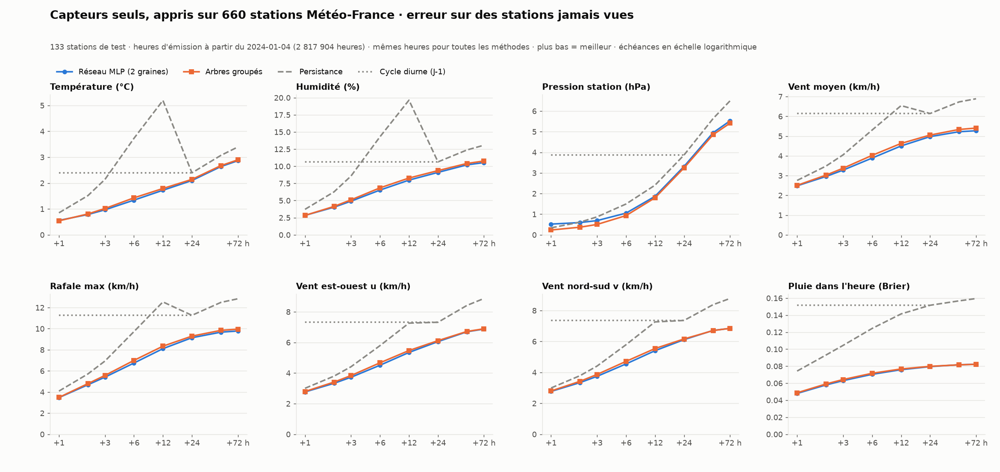

# Modèle « capteurs seuls » appris sur le réseau Météo-France — résultats

Évaluation unique sur le test, faite les 12 et 13 novembre 2026 selon le [protocole](PROTOCOLE.md) écrit avant tout entraînement.

## La question

La station de Télécom Saint-Étienne mesurera la température, l'humidité, la pression, le vent, les rafales et la pluie. Peut-on prévoir ces mêmes variables de +1 à +72 h **avec ces seuls capteurs** ?

Pour y répondre, on entraîne un modèle sur les mesures horaires de centaines de stations Météo-France, puis on le teste sur des stations qu'il n'a jamais vues, comme le sera celle de Télécom.

## Ce qui a été fait

- **Données** : 881 stations Météo-France ayant au moins 2 ans de température, d'humidité, de vent et de pluie, de 2000 à octobre 2026, réduites aux 7 mesures de la station de Télécom.
- **Découpage** : 660 stations pour l'apprentissage (jusqu'en 2021), 88 pour le choix du modèle (2022-2023) et 133 pour le test, plus SAINT-ETIENNE (à partir du 4 janvier 2024). Les stations de test et leurs années n'ont jamais servi à entraîner ni à choisir les modèles.
- **Modèles comparés** :

  | Famille | Configuration | Score de validation |
  | --- | --- | ---: |
  | Réseau MLP (retenu, 2 graines) | entraîné sur une RTX A5000 | 0,748 |
  | Réseau GRU | idem | 0,752 |
  | Réseau convolutif (TCN) | idem | 0,777 |
  | Arbres groupés | un gradient boosting par variable et par échéance, sur 1 million d'heures tirées au hasard | 0,733 |

  Le score de validation est le rapport d'erreur à la persistance, moyenné sur toutes les variables et échéances. 1 = persistance, plus bas = mieux.
- **Références** : la persistance (même valeur que maintenant) et le cycle diurne (valeur d'il y a 24 h).

## Résultats sur les 133 stations de test



Erreur absolue moyenne (Brier pour la pluie), de janvier 2024 à octobre 2026, sur 2,8 millions d'heures d'émission :

| Variable | Méthode | +1 h | +3 h | +6 h | +12 h | +24 h | +72 h |
| --- | --- | ---: | ---: | ---: | ---: | ---: | ---: |
| Température (°C) | Réseau | 0,56 | **0,97** | **1,34** | **1,72** | **2,10** | **2,87** |
| | Arbres | **0,54** | 1,02 | 1,43 | 1,79 | 2,14 | 2,90 |
| | Persistance | 0,85 | 2,14 | 3,73 | 5,19 | 2,40 | 3,40 |
| Humidité (%) | Réseau | **2,8** | **4,9** | **6,5** | **8,0** | **9,1** | **10,5** |
| | Arbres | **2,8** | 5,1 | 6,8 | 8,3 | 9,4 | 10,8 |
| | Persistance | 3,7 | 8,6 | 14,3 | 19,6 | 10,6 | 13,1 |
| Pression (hPa) | Réseau | 0,52 | 0,69 | 1,05 | 1,87 | 3,32 | 5,52 |
| | Arbres | **0,23** | **0,50** | **0,93** | **1,80** | **3,25** | **5,41** |
| | Persistance | 0,34 | 0,87 | 1,49 | 2,41 | 3,87 | 6,49 |
| Vent moyen (km/h) | Réseau | **2,5** | **3,3** | **3,9** | **4,5** | **5,0** | **5,3** |
| | Arbres | **2,5** | 3,4 | 4,0 | 4,6 | 5,1 | 5,4 |
| | Persistance | 2,8 | 4,0 | 5,3 | 6,5 | 6,1 | 6,9 |
| Rafale max (km/h) | Réseau | **3,5** | **5,4** | **6,7** | **8,1** | **9,1** | **9,8** |
| | Arbres | **3,5** | 5,6 | 7,0 | 8,3 | 9,3 | 10,0 |
| | Persistance | 4,1 | 6,9 | 9,7 | 12,5 | 11,3 | 12,8 |
| Pluie dans l'heure (Brier) | Réseau | **0,048** | **0,063** | **0,070** | **0,076** | **0,079** | **0,082** |
| | Arbres | 0,049 | 0,064 | 0,072 | 0,077 | 0,080 | **0,082** |
| | Persistance | 0,074 | 0,104 | 0,124 | 0,141 | 0,152 | 0,159 |

Chiffres complets (RMSE, biais, direction u/v, toutes les échéances) : [metrics.json](metrics.json) pour le réseau et les références, [trees_metrics.json](trees_metrics.json) pour les arbres.

## Saint-Étienne

La station 42218011 compte 24 533 heures d'émission sur la même période. Elle n'a pas de baromètre dans les données publiques, donc il n'y a pas de score de pression.

| Variable | Méthode | +1 h | +3 h | +6 h | +12 h | +24 h | +72 h |
| --- | --- | ---: | ---: | ---: | ---: | ---: | ---: |
| Température (°C) | Réseau | 0,59 | **1,02** | **1,45** | **1,94** | **2,43** | **3,40** |
| | Arbres | **0,58** | 1,05 | 1,52 | 1,99 | 2,49 | 3,47 |
| | Persistance | 0,83 | 2,01 | 3,43 | 4,69 | 2,69 | 4,00 |
| Humidité (%) | Réseau | **3,1** | **5,5** | **7,4** | **9,4** | **10,8** | **12,0** |
| | Persistance | 3,7 | 8,1 | 13,0 | 17,3 | 12,4 | 15,5 |
| Vent moyen (km/h) | Réseau | 2,5 | 3,1 | 3,4 | 3,7 | 3,9 | 4,0 |
| | Persistance | 2,8 | 3,7 | 4,4 | 5,0 | 4,9 | 5,2 |
| Rafale max (km/h) | Réseau | 4,0 | 6,0 | 7,1 | 8,1 | 8,7 | 9,1 |
| | Persistance | 4,6 | 7,3 | 9,5 | 11,5 | 11,2 | 12,2 |

**Comparaison avec le modèle appris sur la seule station de Saint-Étienne** ([sensor_horizons](../sensor_horizons/metrics.json)). Ce modèle a vu 2000-2023 de cette station précise. Les erreurs ci-dessous sont calculées sur les mêmes 22 000 à 24 000 heures, avec des observations identiques :

| Variable | Échéance | Réseau multi-stations | Arbres mono-station | Persistance |
| --- | --- | ---: | ---: | ---: |
| Température (°C) | +1 h | 0,59 | **0,56** | 0,83 |
| | +24 h | 2,42 | **2,23** | 2,67 |
| Humidité (%) | +1 h | 3,2 | **3,1** | 3,7 |
| | +24 h | 10,7 | **10,3** | 12,4 |
| Vent (km/h) | +1 h | **2,50** | 2,51 | 2,76 |
| | +24 h | 3,86 | **3,80** | 4,95 |
| Rafale (km/h) | +24 h | 8,7 | **8,4** | 11,2 |
| Pluie (Brier) | +1 h | 0,045 | 0,045 | 0,069 |

Le modèle qui connaît l'historique du site fait 0 à 8 % mieux, surtout pour la température et l'humidité. Le réseau, lui, n'a jamais vu Saint-Étienne et arrive presque au même niveau : c'est la situation de la station de Télécom le premier jour.

## Intervalles de confiance

Les intervalles sont à 95 %. Ils viennent d'un bootstrap par blocs (une station × un mois calendaire), avec 2 000 tirages ([station_bootstrap.py](../../analysis/station_bootstrap.py), [bootstrap.json](bootstrap.json)).

| | Réseau MLP | Arbres groupés | Réseau − arbres |
| --- | --- | --- | --- |
| Score du protocole, 133 stations de test (3 910 blocs) | 0,746 [0,743 ; 0,748] | **0,733 [0,732 ; 0,735]** | +0,012 [+0,011 ; +0,014] |
| Même score sans la pression | **0,721** | 0,735 | −0,014 [−0,015 ; −0,014] |
| SAINT-ETIENNE (34 blocs mensuels) | **0,744 [0,732 ; 0,756]** | 0,753 [0,741 ; 0,764] | −0,009 [−0,011 ; −0,007] |

**Sur les 64 cases variable × échéance des stations de test :**
- le réseau est significativement meilleur sur **50** cases ;
- les arbres sur **10** cases : la pression à toutes les échéances et la température à +1 h ;
- les deux sont **indiscernables sur 4** cases, par exemple l'humidité à +1 h.

Exemples d'erreurs sur les stations de test :

| Variable et échéance | Réseau | Arbres | Réseau − arbres |
| --- | --- | --- | --- |
| Température à +6 h | 1,341 °C [1,333 ; 1,349] | 1,429 °C [1,421 ; 1,437] | −0,088 [−0,090 ; −0,086] |
| Humidité à +6 h | 6,53 % [6,48 ; 6,57] | 6,85 % [6,80 ; 6,90] | −0,32 [−0,33 ; −0,31] |
| Pression à +1 h | 0,521 hPa [0,507 ; 0,536] | 0,234 hPa [0,231 ; 0,238] | +0,286 [+0,274 ; +0,300] |

Les écarts entre méthodes sont petits, mais tous sont réels, sauf sur les 4 cases indiscernables. Pour SAINT-ETIENNE seule, les intervalles sont environ 5 fois plus larges. Le réseau y reste devant sur 35 cases sur 56, et les arbres seulement sur 2.

## Ce qu'on peut conclure

1. **Les capteurs seuls permettent une vraie prévision jusqu'à environ +12 h.** À +6 h, l'erreur est 2 à 3 fois plus petite que celle de la persistance pour la température et l'humidité, et un tiers plus petite pour le vent, les rafales et la pluie. Au-delà de 24 h, les modèles se rapprochent de la moyenne saisonnière, comme prévu sans prévision météo extérieure.
2. **Le modèle se transpose à une station jamais vue.** Les erreurs sur les stations de test sont quasi identiques à celles des stations d'apprentissage. Par exemple, pour la température à +6 h : 1,34 °C sur les stations de test, 1,33 °C sur celles d'apprentissage. Le score sur le test (0,746 pour le réseau) est aussi proche de celui de validation (0,748). Il n'y a donc pas de surapprentissage visible.
3. **Réseau et arbres font presque jeu égal.**
   - Le réseau est meilleur sur 52 cases sur 64 (variable × échéance), de 1 à 5 %. L'écart est significatif pour 50 d'entre elles (voir les intervalles ci-dessus).
   - Les arbres sont nettement meilleurs pour la pression : 0,23 contre 0,52 hPa à +1 h.
   - Selon le score fixé par le protocole, les arbres l'emportent sur les stations de test (0,733 contre 0,746), uniquement à cause de la pression. Sans la pression, le réseau est devant (0,721 contre 0,735). À Saint-Étienne, le réseau est devant (0,744 contre 0,753).

   Sur les stations d'apprentissage, on retrouve le même tableau (0,742 contre 0,733).
4. **Changer d'architecture ne rapporte presque plus rien.** MLP, GRU et TCN finissent à moins de 4 % les uns des autres, et tous ont atteint leur meilleur score en 3 à 8 époques. La limite vient de l'information contenue dans 7 capteurs, pas de la taille du modèle ni de la puissance de calcul.

**Pour la station de Télécom**, la recommandation est d'utiliser le réseau pour toutes les variables et les arbres pour la pression. Cette répartition a été observée sur le test, après coup : elle reste à confirmer, par exemple sur les premiers mois de données de la vraie station. Pour la pression à +1 h, le réseau ne fait pas mieux que la persistance.

## Écarts au protocole

Tous sont détaillés et datés dans la section « Amendements » du [protocole](PROTOCOLE.md) :

- **Échantillon des arbres** réduit de 3 à 1 million d'heures, faute de mémoire vive et de temps. Décidé avant toute prédiction sur le test.
- **Code d'évaluation** des réseaux puis des arbres modifié pour tenir en mémoire : calcul par groupes de stations et par tranches, avec addition des erreurs. Les modèles retenus n'ont pas changé. Avant d'évaluer, le script vérifie que le code qui les a entraînés est bien la version enregistrée dans git : commit `386557a` pour les réseaux, `ab19c2f` pour les arbres.
- **Étiquette de carte erronée** : `selection.json` indique « GTX 1650 », mais l'entraînement a bien tourné sur `cuda:1`, la RTX A5000 24 Go. L'appareil est correct ; seul le nom enregistré est faux, à cause d'une étiquette lue sur la mauvaise carte.

## Limites

- Les capteurs et leur emplacement sont ceux de Météo-France : abri normalisé, anémomètre à 10 m. La station de Télécom aura ses propres écarts. Il faudra une période de comparaison avec SAINT-ETIENNE pour les mesurer et les corriger (voir la [fiche de format](../../docs/FORMAT_DONNEES_STATION.md)).
- Une partie de 2025-2026 avait déjà été regardée pour SAINT-ETIENNE dans les études du vent. Pour cette station, le test n'est donc pas totalement « jamais vu » ; il l'est pour les 133 autres stations de test.
- Le score de choix fait la moyenne de rapports à la persistance. Une variable où la persistance est très bonne, comme la pression à +1 h, pèse donc beaucoup dans ce score.

## Reproduire

```sh
python analysis/build_station_dataset.py                    # data/stations (4,4 Go)
python analysis/station_network.py --phase select           # environ 2 h sur une carte de 24 Go
python analysis/station_network.py --phase evaluate
python analysis/station_trees.py --phase select --threads 5     # environ 2 h 45 sur 8 cœurs
python analysis/station_trees.py --phase evaluate --threads 8   # environ 11 h sur 8 cœurs, dont 10 pour les stations d'apprentissage
python analysis/station_bootstrap.py                         # intervalles, environ 45 min
python analysis/compare_single_station.py
python analysis/plot_station_network.py
```
