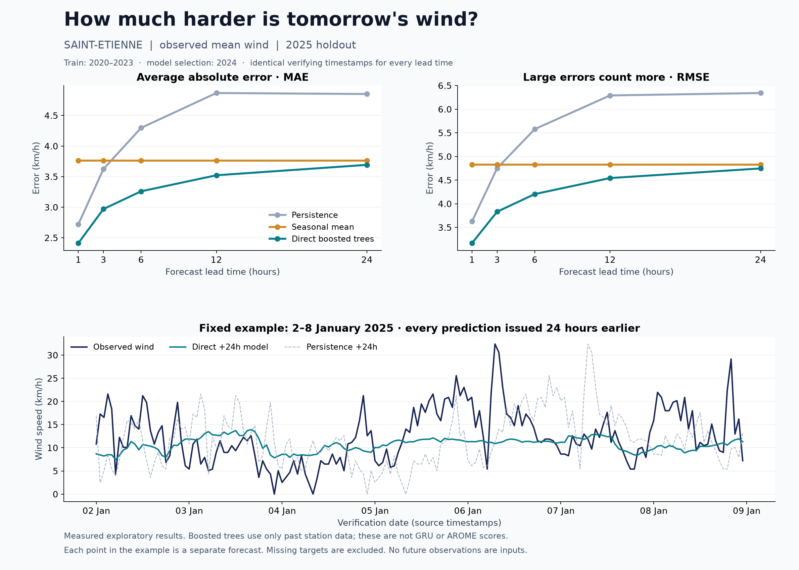

# Moving Saint-Etienne wind forecasting to 24 hours

## Recommendation

Build a **local correction of numerical weather forecasts**, using recent station observations alongside archived forecasts from AROME and/or ECMWF. Benchmark the uncorrected forecast first, then train a modest model to correct its errors at this station. A larger GRU trained only on one station's past measurements is an experiment worth comparing, but cannot be assumed to anticipate approaching weather systems better.

This recommendation follows the meteorological need to represent the evolving surrounding atmosphere and the results below. It is not a claim that an untested hybrid already achieves a particular error here. [Meteo-France describes its numerical forecast models](https://meteofrance.com/meteo-a-z/les-modeles-de-prevision-meteo); [ECMWF has evaluated machine learning corrections for wind-speed forecasts](https://www.ecmwf.int/en/elibrary/81297-statistical-modelling-2m-temperature-and-10m-wind-speed-forecast-errors).

## New measured experiment

The accompanying script trains separate direct **wind-speed** models for +1, +3, +6, +12 and +24 hours. These models use gradient-boosted trees, not the repository's GRU. No numerical-weather-model forecast inputs were used in this experiment.

- Training target dates: 2020–2023.
- Validation: 2024, used to choose 50, 100 or 200 boosting iterations by RMSE.
- Test valid dates: January 2–December 31, 2025. Starting on January 2 ensures every forecast issue time follows the validation period.
- Test size: 8,730 observed targets, shared by every horizon and method.
- Inputs: current/past speed, gust measurements, direction components, temperature, dew point, humidity, pressure and precipitation; lags/rolling features up to 72 hours; the known future calendar.
- Persistence: the wind **observed at issue time**, kept unchanged until the target hour.
- Seasonal mean: historical mean wind for the target month and hour, fitted on training years only.

| Forecast | MAE (km/h) | RMSE (km/h) |
| --- | ---: | ---: |
| +1 h boosted trees | 2.41 | 3.17 |
| +3 h boosted trees | 2.97 | 3.83 |
| +6 h boosted trees | 3.26 | 4.20 |
| +12 h boosted trees | 3.52 | 4.54 |
| **+24 h boosted trees** | **3.69** | **4.75** |
| +24 h persistence | 4.85 | 6.34 |
| +24 h seasonal mean | 3.76 | 4.83 |



The 24-hour model reduces MAE by 23.9% against persistence, but only **1.8% against the seasonal mean**. An approximate paired block bootstrap gives a 95% interval of -0.04% to 3.79% for its MAE improvement over the seasonal mean. That small advantage is not convincing evidence of reliable day-ahead skill.

For the 826 test observations with wind at least **16.2 km/h** (the training-set 90th percentile), the 24-hour model's MAE is **9.27 km/h**, RMSE **9.95 km/h**, and bias **-9.27 km/h**. This is a locally defined higher-wind subset, not a severe-wind warning threshold. The model underpredicts every observation in this subset. An acceptable-looking overall score is therefore insufficient to call this good weather prediction.

The bottom plot uses a fixed example, January 2–8, rather than a period selected for attractive predictions. Every plotted prediction has a different issue time, always 24 hours before its valid time. It is not a week-long forecast issued once.

The existing GRU's recorded 2.67 km/h MAE and 3.53 km/h RMSE are from a different one-hour experiment with different splits and preprocessing. They are not a fair model-to-model comparison with this experiment, and no 24-hour GRU score has been measured here.

## Specify the product first

For a useful next-day forecast, predict the **24 hourly values t+1 through t+24 from the same issue time t**. Evaluate each lead time separately.

In the existing `dataset.py`, setting `horizon=24` predicts **only t+24**, with two outputs representing the wind vector. It does not generate a 24-point trajectory and does not represent a daily average. For 24 hourly vector predictions, the target/output shape should be `[batch, 24, 2]`; for speed-only forecasts it should be `[batch, 24]`.

A direct multi-output model is a sensible first design. Avoid initially rolling a one-hour model forward 24 times: this also requires future temperature, pressure and other inputs that the current model does not produce.

## Changes required before trusting the GRU's day-ahead score

1. **Retain actual timestamps.** Sort, reject duplicate timestamps and reindex hourly before computing lags. The raw station files have 157 missing hourly rows across 11 gaps. A 24-row shift without reindexing can cross more than 24 hours.
2. **Keep targets observed.** The current preprocessing forward-fills FF and DD along with predictors. Raw FF is missing in 254 station rows. Never replace missing target observations with an invented training/evaluation label. Use limited causal filling for predictors with missingness flags; no backfill from the future.
3. **Fix the persistence baseline.** `np.roll(ff_real, 1)` in `train.py` becomes actual `FF(t+23)` when predicting `FF(t+24)`. That future observation is unavailable at time t. Use `FF(t)` and score identical target cases for every method.
4. **Include the latest available wind.** The current dataset excludes FF and the vector target columns from inputs. Past FF and past vector components are valid predictors. Retain information through the issue time, accounting for any real observation reporting delay.
5. **Match model selection to the desired metric.** Current training minimizes standardized vector MSE, while final scores measure speed. With uncertain direction, averaging vectors can reduce their magnitude. Compare a nonnegative speed head trained with squared error/Huber against vector prediction; select using speed errors on validation. Quantile loss can add P10/P50/P90 forecasts, with interval coverage checked afterward. MAE and RMSE favour different point estimators; an improvement in one is not guaranteed to improve the other.
6. **Correct the bidirectional readout if retaining that architecture.** `out[:, -1, :]` does not contain the complete reverse-direction final summary. Concatenate the final forward/reverse states from `h_n`, or compare a unidirectional GRU. Bidirectionality over historical inputs itself is not future leakage.
7. **Save the whole inference contract.** Store scalers, ordered feature names, units, wind-vector convention, model configuration, horizon and split dates with weights. Existing weights alone are insufficient for reliable deployment.

When incorporating meteorological u/v forecasts, consistently use `u=-speed*sin(direction)` and `v=-speed*cos(direction)` for wind direction expressed as degrees **from** north. The existing `FF*cos(DD), FF*sin(DD)` encoding preserves speed magnitude but uses a different component convention.

## Recommended next model

Use recent observations, known target calendar features and forecasts available at issue time:

```text
Past 24–72 h of local observations ───────┐
AROME / ECMWF forecasts for t+1…t+24 ─────┼─> local correction model
Target hour + season + station metadata ─┘       │
                                                └─> 24 hourly wind forecasts
                                                    + uncertainty intervals
```

Start by comparing 24/48/72-hour observation windows on validation; these are candidates, not guaranteed optimum settings. Benchmark boosted trees before investing in a more complex GRU. Nearby stations and pressure gradients may add useful context, but only observations available by the issue time may be inputs. For pressure, Saint-Etienne is entirely missing PSTAT in these files; the current pipeline supplies it from Boutheon.

For a residual model, the target can be `observed wind - numerical model forecast`; add the learned correction to the numerical forecast at inference. Compare this against both raw numerical forecasts and a direct speed model. Treat gust speed as a separate target and check direction separately if those are product requirements.

Training requires **archived forecasts at the appropriate lead time**, not tomorrow's observations or a reanalysis of tomorrow. Open-Meteo's [Previous Runs API](https://open-meteo.com/en/docs/previous-runs-api) exposes fixed lead times including the previous-day forecast. For a complete curve from one issue time, use an archive that preserves individual runs, such as the [Single Runs API](https://open-meteo.com/en/docs/single-runs-api), subject to model-specific historical coverage. Match run availability, valid time, station location/elevation and measurement definition. The [Historical Forecast API documentation](https://open-meteo.com/en/docs/historical-forecast-api) explains why a series stitched from each run's first hours is different from a historical day-ahead forecast. Check archive coverage before choosing new hybrid training/test dates.

## Acceptance criteria

- Use chronological rolling validation, with a final period untouched by model selection. Training targets must precede validation/test forecast issue times.
- Report MAE, RMSE and bias by lead time, season and wind-strength group. Keep each method on the same observations.
- Compare against persistence, seasonal means and raw numerical forecasts. A low score alone does not establish useful skill.
- Add prediction intervals and check their coverage/width, including during higher winds; an interval label alone does not ensure calibration.
- Evaluate direction using circular errors only where direction is meaningful, and gusts separately from mean wind.
- Examine missed wind increases and threshold-event skill, not only averages. Reweighting storms can alter overall MAE/RMSE, so make that trade-off explicit.
- Validate gains over multiple historical periods and use paired time blocks for uncertainty; neighbouring hourly errors are correlated.

The achievable error is an empirical result. There is no honest guarantee that a 24-hour forecast can retain today's one-hour MAE or RMSE.

## Reproduce this diagnostic

From the repository root, with the raw CSVs present:

```bash
.venv/bin/python -m pip install numpy pandas scikit-learn matplotlib
.venv/bin/python analysis/wind_horizon_study.py
```

Artifacts are `metrics.json`, `horizon_metrics.csv`, `predictions_24h.csv`, `wind_horizon_results.png` and `wind_horizon_results.svg` in this directory. CSV outputs remain ignored by the repository's existing `*.csv` rule. `metrics.json` records library versions, split policy, model selection, audit counts, detailed metrics and the script hash.

Limitations: this is one exploratory test year, historical observation availability is assumed immediate, and quality flags have not been independently audited beyond excluding missing/negative FF. The bootstrap uses blocks of 168 consecutive scored observations, approximately a week after missing-case exclusion. This historical dataset has already been used by earlier project work; it is not a never-viewed external test set. No NWP hybrid or GRU was retrained in this diagnostic.
