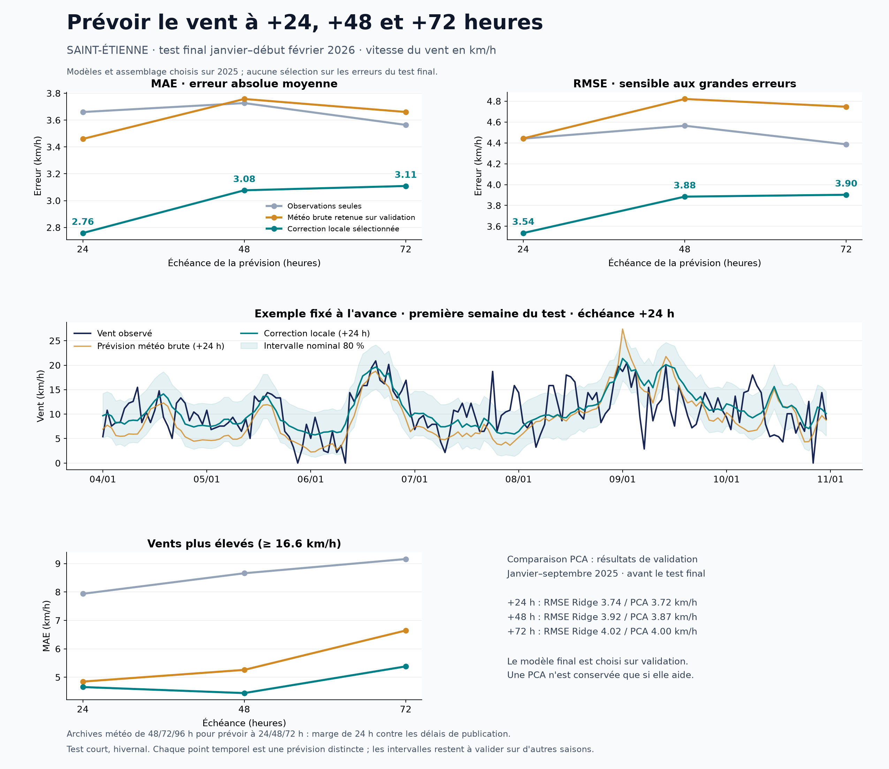

# Prévision du vent à +24, +48 et +72 heures

## Résultat obtenu

Un nouveau pipeline a été entraîné et évalué. Il combine les prévisions météorologiques de quatre modèles et les observations récentes de Saint-Étienne pour apprendre une correction locale. La sélection des modèles utilise uniquement 2025 ; les résultats ci-dessous proviennent du test final du **4 janvier au 4 février 2026 à 03 h UTC**, avec **748 observations communes** aux trois échéances.

| Échéance | MAE observations seules | MAE météo brute de référence | MAE modèle retenu | RMSE modèle retenu | Gain de MAE sur météo brute |
| --- | ---: | ---: | ---: | ---: | ---: |
| +24 h | 3,66 | 3,46 | **2,76** | **3,54** | **20,3 %** |
| +48 h | 3,73 | 3,76 | **3,08** | **3,88** | **18,1 %** |
| +72 h | 3,56 | 3,66 | **3,11** | **3,90** | **15,1 %** |

Toutes les erreurs sont en km/h. « Observations seules » désigne le nouveau modèle à arbres utilisant uniquement l'historique de la station. La référence météo brute, choisie sur validation, est ici la moyenne des quatre modèles numériques. Les modèles retenus améliorent aussi la RMSE de cette référence : 4,44 → 3,54 ; 4,82 → 3,88 ; 4,75 → 3,90 km/h.



Il s'agit d'une amélioration mesurée sur une période courte et hivernale, pas d'une garantie de performance annuelle. La période 2025 avait déjà été examinée dans le benchmark précédent ; elle sert maintenant au développement. Les résultats 2026 n'ont pas été utilisés pour modifier les candidats, leurs paramètres ou les pondérations retenues.

## Méthode retenue

Les entrées réunissent :

- les observations disponibles au moment de la prévision : vitesse et direction du vent, rafales passées, température, point de rosée, humidité, pression et précipitations ;
- des retards et statistiques glissantes jusqu'à 72 heures, ainsi que les indicateurs de données manquantes ;
- les prévisions ECMWF IFS 0,25°, ICON Global, ICON Europe et GFS Global de vent, direction, température et pression, leur moyenne et leur dispersion ;
- l'heure et la saison de la date cible, qui sont connues à l'avance.

Deux modèles à arbres sont assemblés : l'un prédit directement la vitesse du vent, l'autre prédit la correction à ajouter à la moyenne météo brute. La vitesse finale est non négative.

| Échéance | Assemblage choisi sur validation |
| --- | --- |
| +24 h | 50 % correction résiduelle HGB à 7 feuilles + 50 % HGB direct à 15 feuilles |
| +48 h | 50 % HGB direct à 15 feuilles + 50 % correction résiduelle HGB à 7 feuilles |
| +72 h | 75 % HGB direct à 15 feuilles + 25 % correction résiduelle HGB à 7 feuilles |

HGB désigne ici `HistGradientBoostingRegressor`. Le nombre d'itérations est choisi parmi 75, 150 et 300. L'apprentissage des trois échéances est direct : on n'injecte pas récursivement une prédiction à une heure dans 72 étapes successives. Le produit actuel fournit trois valeurs, pour +24/+48/+72 h, et non les 72 valeurs horaires intermédiaires.

## PCA et méthodes récentes

La PCA a été testée réellement dans une chaîne imputation → standardisation → PCA → Ridge, avec conservation de 95 % ou 99 % de la variance. Toutes les transformations sont ajustées sur l'apprentissage uniquement.

| Validation 2025 : correction linéaire météo | +24 h RMSE | +48 h RMSE | +72 h RMSE |
| --- | ---: | ---: | ---: |
| Ridge sans PCA | 3,74 | 3,92 | 4,02 |
| PCA 95 % + Ridge | 3,72 | 3,87 | 4,00 |

La PCA améliore légèrement la correction linéaire dans cet essai, mais les ensembles à arbres sont meilleurs selon le critère de sélection. La PCA n'est donc pas intégrée au modèle retenu. Ce résultat est cohérent avec son rôle : elle conserve la variance des entrées, pas nécessairement l'information qui prédit le mieux la cible. [Exemple officiel PCA et régression](https://scikit-learn.org/stable/auto_examples/cross_decomposition/plot_pcr_vs_pls.html).

Le choix technique principal est le post-traitement local de plusieurs prévisions météorologiques, puis leur assemblage validé chronologiquement. Les travaux d'[ECMWF sur la correction des prévisions de vent](https://www.ecmwf.int/en/elibrary/81297-statistical-modelling-2m-temperature-and-10m-wind-speed-forecast-errors) soutiennent cette approche. Une [étude publiée en prépublication en avril 2026](https://arxiv.org/abs/2604.19340) trouve également des avantages aux arbres et à la sélection de variables dans son propre cas de post-traitement météo ; ses résultats ne sont pas transférés comme une promesse pour cette station.

## Données et prévention des fuites temporelles

Station utilisée : **42218011 — SAINT-ETIENNE**, latitude **45,435333**, longitude **4,368167**, altitude **640 m**. Les dates des observations horaires métropolitaines sont en UTC, conformément à la [documentation Météo-France](https://www.data.gouv.fr/datasets/donnees-climatologiques-de-base-horaires).

Les observations sont triées et réindexées à fréquence horaire. Les cibles absentes ne sont jamais remplies. Les entrées peuvent être prolongées vers l'avant pendant trois heures maximum ; aucune interpolation avec des observations futures n'est utilisée. La pression est complétée par Bouthéon. Les cibles sont des vitesses, pas des normes de vecteurs moyens susceptibles de s'annuler quand la direction devient incertaine.

Les prévisions externes proviennent de l'[API Previous Runs d'Open-Meteo](https://open-meteo.com/en/docs/previous-runs-api), pas d'une réanalyse ni d'observations futures. Les fichiers sont gelés localement avec les URL exactes, unités, coordonnées, contrôles de couverture et empreintes SHA256. AROME et ARPEGE n'ont pas été retenus : les requêtes historiques testées renvoyaient des valeurs manquantes. Ces absences n'ont pas été remplacées par d'autres données sous leur nom.

**Correction importante du délai de disponibilité :** l'inspection du code source d'Open-Meteo montre que les décalages journaliers s'appuient sur l'initialisation du modèle, sans vérifier la date réelle de publication. Une initialisation à 00 h peut n'être publiée que plusieurs heures plus tard. Voir [sélection des décalages](https://github.com/open-meteo/open-meteo/blob/main/Sources/App/Helper/OmFileSplitter.swift) et [horodatage à partir du run](https://github.com/open-meteo/open-meteo/blob/main/Sources/App/Helper/Writer/GenericVariableHandle.swift).

Pour éviter d'utiliser une prévision potentiellement indisponible à l'heure d'émission, le pipeline ajoute une **marge de 24 heures** :

| Prévision locale émise à t | Date cible | Décalage de l'archive météo | Initialisation du bulletin utilisé |
| --- | --- | --- | --- |
| +24 h | t+24 h | 48 h | au plus tard t−24 h |
| +48 h | t+48 h | 72 h | au plus tard t−24 h |
| +72 h | t+72 h | 96 h | au plus tard t−24 h |

C'est un protocole conservateur qui suppose une publication en moins de 24 heures. Les éventuelles pannes historiques ne sont pas vérifiables avec cette API. La référence brute utilise exactement les mêmes bulletins vieillis : elle ne représente pas la meilleure prévision fraîche disponible en exploitation. Une comparaison avec des bulletins plus récents nécessiterait leurs heures de publication exactes.

La couverture commune des quatre modèles et des trois décalages conservateurs commence le 7 février 2024. Les données antérieures restent manquantes pour la météo numérique ; elles peuvent servir à l'apprentissage des modèles fondés uniquement sur les observations.

## Découpage, sélection et intervalles

1. Apprentissage initial : cibles antérieures au 1er janvier 2025.
2. Sélection des paramètres et de l'assemblage : cibles du 4 janvier au 30 septembre 2025.
3. Réentraînement des paramètres figés : toutes les cibles disponibles antérieures au 1er octobre 2025.
4. Calibration des intervalles : cibles du 4 octobre au 31 décembre 2025.
5. Test final : cibles du 4 janvier au 4 février 2026, avec toutes les heures d'émission postérieures ou égales au 1er janvier 2026.

Les débuts de périodes comportent une séparation de 72 heures pour que les cibles de la période précédente ne dépassent jamais l'heure d'émission de la suivante. Les méthodes et échéances sont évaluées sur les mêmes dates valides. `selection.json` est écrit avant le calcul des erreurs du test final.

Le critère de sélection donne un poids égal à MAE/MAE-climatologique et RMSE/RMSE-climatologique. Il évite de choisir une méthode uniquement sur un score en ignorant l'autre. Les ensembles testent des poids simples 25/50/75 % parmi les trois meilleurs candidats de validation.

Les intervalles nominaux à 80 % utilisent un quantile des erreurs absolues de calibration séparée (méthode de type split conformal). Leur couverture mesurée est de **81,6 %**, **77,9 %**, **80,5 %**, respectivement à +24/+48/+72 h, pour des largeurs moyennes d'environ **9,08**, **9,32**, **9,86 km/h**. La dépendance temporelle et les changements saisonniers empêchent de présenter ce pourcentage comme une garantie universelle.

## Vents plus élevés et limites

Le seuil du 90e percentile d'apprentissage vaut **16,56 km/h**. Il ne s'agit pas d'un seuil de tempête. Il y a seulement **41 observations** au-dessus de ce seuil dans le test final.

| MAE sur ces observations | +24 h | +48 h | +72 h |
| --- | ---: | ---: | ---: |
| Observations seules | 7,94 | 8,66 | 9,16 |
| Météo brute de référence | 4,85 | 5,26 | 6,64 |
| Modèle retenu | **4,66** | **4,44** | **5,38** |

Les pics restent sous-estimés. Les biais moyens sur l'ensemble du test sont +0,35/+0,72/+0,97 km/h, alors que les biais sur les vents plus élevés restent négatifs. Un faible score moyen ne signifie donc pas que toutes les situations sont correctement anticipées.

Les intervalles bootstrap de gain de MAE sont exploratoires : ils reposent sur seulement cinq blocs d'environ une semaine. La prochaine validation doit couvrir d'autres saisons et davantage d'épisodes venteux, puis mesurer le comportement avec de vrais bulletins horodatés et des délais réels de remontée des observations. Les scores de l'ancien GRU et du benchmark 2025 portent sur d'autres périodes et ne doivent pas être directement soustraits à ceux-ci.

## Utilisation et fichiers

Depuis la racine du dépôt, avec les deux CSV bruts présents :

```bash
source .venv/bin/activate
python -m pip install -r requirements-wind.txt
python analysis/fetch_nwp_archive.py
python analysis/fetch_nwp_archive.py --horizons 96 --output-dir reports/wind_advanced/data/day4
python analysis/train_wind_advanced.py
python analysis/plot_wind_advanced.py
python -m unittest discover -s tests -v
```

Rejouer une prévision historique à une heure fixée :

```bash
python analysis/train_wind_advanced.py --predict-at 2026-02-01T00:00:00Z
```

Cette commande utilise les modèles sauvegardés et les seules entrées correspondant à cette heure. Les intervalles ne sont autorisés qu'après la fin de leur calibration. Le schéma des variables et la liste des modèles météo doivent correspondre aux artefacts sauvegardés. Le jeu de données actuel s'arrête le 4 février 2026 : cette commande ne constitue pas un service de prévision en temps réel pour aujourd'hui.

Principaux artefacts : `wind_models.joblib` (modèles, prétraitements, schéma, assemblages et calibration), `selection.json`, `metrics.json`, `all_scores.csv`, `predictions_24h.csv`, `predictions_48h.csv`, `predictions_72h.csv`, `exemple_prevision.json`, ainsi que les graphiques PNG/SVG. Les données téléchargées, CSV et modèles ajustés restent locaux et sont ignorés par Git.
