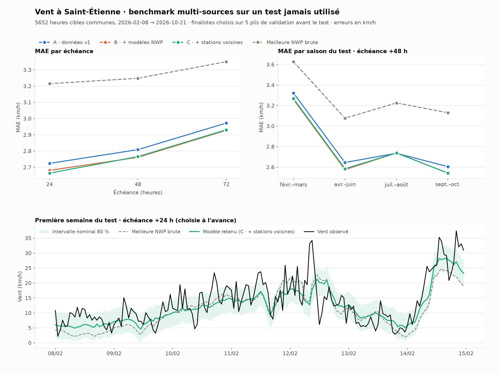

# Benchmark multi-sources — vent à Saint-Étienne (+24 / +48 / +72 h)

Protocole rédigé avant tout entraînement : [PROTOCOLE.md](PROTOCOLE.md). La sélection a été figée dans [selection.json](selection.json) avant la lecture d'une seule cible du test. Le test a été évalué une seule fois.

## Résultat principal

Le test porte sur **5 652 heures cibles communes, du 8 février au 21 octobre 2026**. Cette période n'avait jamais été utilisée : fin d'hiver, printemps, été et début d'automne. Erreurs en km/h :

| Échéance | NWP brute (moy. 6 modèles) | A · données v1 | B · + modèles NWP | C · + stations voisines | Retenu sur validation |
| --- | ---: | ---: | ---: | ---: | --- |
| +24 h | 3.22 | 2.72 | 2.68 | **2.66** | C (MAE 2.66, RMSE 3.51) |
| +48 h | 3.25 | 2.81 | **2.76** | 2.77 | B (MAE 2.76, RMSE 3.63) |
| +72 h | 3.35 | 2.97 | **2.93** | 2.93 | B (MAE 2.93, RMSE 3.86) |



1. **La correction locale tient sur une nouvelle période.** Le modèle retenu améliore la meilleure NWP brute de **17,1 % / 15,0 % / 12,6 %** en MAE. Intervalles bootstrap par semaines : [15,1 ; 19,5], [12,3 ; 17,8] et [10,0 ; 15,3]. La méthode v1 (A), figée sur un mois d'hiver, se généralise donc aux autres saisons.
2. **Ajouter GEM, JMA et 6 variables NWP aide un peu, mais de façon régulière** : B fait **1,6 % / 1,7 % / 1,5 %** de MAE en moins que A. Les intervalles excluent zéro aux trois échéances, et le gain apparaît dans chaque saison sauf juillet–août à +48/+72 h.
3. **Les stations voisines n'apportent presque rien de plus.** Le gain de C sur B est de **+0,6 % à +24 h** [0,2 ; 1,2], puis nul à +48 h (−0,2 %) et à +72 h (−0,1 %). L'information à l'heure d'émission s'efface rapidement à ces échéances. Ce résultat était déjà visible en validation (0,3 % à +24 h).
4. **Les vents forts restent sous-estimés.** Au-dessus du 90e percentile du développement (16,2 km/h, 505 heures du test), le biais du modèle retenu est de **−4,9 / −5,3 / −6,8 km/h**. Le gain moyen ne règle pas ce défaut.
5. **Les intervalles à 80 % sont maintenant bien calibrés** : couverture mesurée de **81,6 % / 82,3 % / 81,4 %**, pour une largeur moyenne de 8,8 à 9,4 km/h. Ils sont calibrés sur les résidus hors pli de cinq plis couvrant toutes les saisons, au lieu de trois mois d'automne dans l'étude précédente.

## Validation et choix

La validation glissante comporte 5 plis : chaque trimestre de 2025, puis du 1er janvier au 4 février 2026. Le classement A < B ≈ C du test était déjà celui de la validation. Les finalistes sont des gradient boostings, en mode résiduel à +24/+48 h et direct à +72 h. La régression Ridge n'est jamais finaliste.

Avec plus d'historique, le gain par rapport à la NWP progresse légèrement : à +24 h, le rapport MAE corrigée / MAE NWP passe de 0,87 (1 an d'apprentissage) à 0,85 (2 ans). Les plis couvrent des saisons différentes, c'est donc un indice et non une preuve que davantage d'années aiderait.

Les scores par pli, tous les candidats et le nombre d'itérations figurent dans [selection.json](selection.json). Les scores du test pour les 39 variantes, par saison et pour les vents forts, sont dans [all_scores.csv](all_scores.csv) et [metrics.json](metrics.json).

## Comparaison avec l'étude précédente

La baseline figée de février 2026 avait obtenu 2,76 / 3,08 / 3,11 km/h, mais sur 748 heures de janvier 2026. Ces chiffres **ne sont pas comparables** à ceux-ci : la période est différente et l'hiver est plus venteux. La comparaison valide est A contre B contre C, sur les mêmes heures.

Le BiLSTM n'est pas réentraîné ici : l'espace disque ne permet pas d'installer PyTorch.

## Données et reproductibilité

```bash
python analysis/fetch_meteofrance.py          # 42, 69, 43, 63 — exports horaires data.gouv.fr
python analysis/fetch_nwp_archive.py --start 2024-01-01 --end 2026-10-21 --horizons 48 72 96 \
  --models ecmwf_ifs025 icon_global icon_eu gfs_global gem_global jma_seamless \
  --variables wind_speed_10m wind_direction_10m temperature_2m surface_pressure wind_gusts_10m \
              wind_speed_100m pressure_msl relative_humidity_2m cloud_cover precipitation \
  --output-dir data/nwp_multisource
python analysis/benchmark_wind_multisource.py --phase select
python analysis/benchmark_wind_multisource.py --phase evaluate
python analysis/plot_wind_multisource.py
python -m unittest discover -s tests -v
```

Données dans `data/`, ignoré par Git. Les empreintes SHA-256 des exports Météo-France et de l'archive NWP sont dans `metrics.json`. L'export « latest » de Météo-France grossit chaque jour : relancer `fetch_meteofrance.py --refresh` change les entrées et l'empreinte.

- **Durées sur CPU, 4 fils** : environ 45 min pour la sélection (225 entraînements) et environ 10 min pour l'évaluation.
- **Quantités** : 17 488 heures de développement, 383 variables dans l'ensemble C.

## Limites

- **Profondeur de l'archive NWP** : Open-Meteo Previous Runs ne commence qu'en janvier 2024, ce qui laisse 2 ans d'apprentissage pour les modèles corrigeant la NWP.
- **Délais de publication** : les décalages d'archive suivent l'heure d'initialisation des modèles, pas l'heure réelle de publication. Une marge de 24 h est imposée, mais les pannes historiques ne sont pas reconstituées. Les observations sont supposées disponibles à leur horodatage.
- **Test récent** : la fin de la période (septembre–octobre 2026) provient de l'export « latest », dont le contrôle qualité Météo-France peut encore évoluer.
- **Prévisions au point** : un seul point par modèle, sans grille ni cellules voisines, et sans AROME ni ARPEGE (archives vides).
- **Bootstrap indicatif** : il repose sur 35 blocs hebdomadaires et les séries sont dépendantes. Les intervalles décrivent la variabilité, ils ne garantissent pas le comportement d'une autre année.

## Suite

1. **Allonger l'historique NWP** avec le reforecast GEFS de la NOAA (2000–2019, vraies échéances).
2. **Corriger les vents forts** : quantiles, ou pondération choisie en validation.
3. **Apprendre sur plusieurs stations**, puis réévaluer un réseau neuronal sur ce même découpage. C'est là qu'un GPU de 24 Go deviendrait utile.
