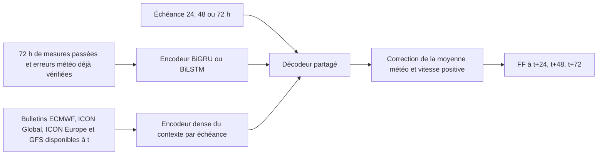

# Réseau récurrent de correction météo

## Ce que le réseau prévoit

À une émission `t` en UTC, le réseau reçoit les 72 dernières heures (`t−71` à `t`) et produit trois vitesses du vent : **FF(t+24), FF(t+48), FF(t+72)**, en km/h. Il ne prévoit ni les rafales ni la direction comme sorties. Chaque sortie correspond à une heure cible précise ; ce n'est pas une moyenne sur 24 h et les valeurs intermédiaires ne sont pas générées.

Un graphique présentant un mois de prévisions à +24 h contient des émissions successives : chaque point utilise les observations disponibles 24 h avant sa cible. Ce graphique n'est donc pas une unique prévision d'un mois. Le rejeu `--predict-at` affiche les trois cibles d'une seule émission et rend cette distinction explicite.

## Entrées et causalité

Les observations sont remises sur une grille horaire exacte. Les trous sont conservés. Un remplissage vers l'avant est limité à trois heures, puis la médiane d'apprentissage remplace les valeurs encore manquantes. Des indicateurs de valeurs manquantes accompagnent les entrées. Les cibles absentes restent masquées dans la perte et les scores.

La séquence inclut la vitesse, la direction codée par sinus/cosinus et composantes météorologiques `u=−FF sin(DD)`, `v=−FF cos(DD)`, les rafales observées, température, humidité, point de rosée, pression, précipitations et calendrier. Elle inclut aussi les erreurs des bulletins vérifiés **au plus tard à t**. Une erreur sur un vent futur n'est jamais fournie au réseau.

Le contexte reprend les variables historiques calculées de la baseline, le calendrier cible et les quatre bulletins météo. Les prévisions ont des heures de validité futures, mais leur initialisation est passée. La marge conservatrice de disponibilité de 24 h de la baseline est conservée. Les observations sont supposées disponibles à leur horodatage ; leur délai réel de transmission n'a pas été mesuré.

Le caractère bidirectionnel concerne uniquement l'ordre de lecture de la fenêtre passée. Lire cette fenêtre dans les deux sens n'expose pas la cible future. Les états finaux avant/arrière résument chacun toute la fenêtre ; prendre simplement la dernière ligne des sorties bidirectionnelles serait incorrect pour résumer la direction arrière.

## Cellules, attention et sorties

Les trois candidats récurrents utilisent une couche de 48 unités par direction, un contexte dense de 48 unités, un vecteur d'échéance de dimension 8 et un petit décodeur partagé. Le BiLSTM remplace uniquement la cellule récurrente. La variante attention du BiGRU pondère les heures passées selon le contexte météo et l'échéance ; elle n'est pas une implémentation du Temporal Fusion Transformer complet.

Le dernier neurone démarre avec des poids nuls : avant apprentissage, la sortie reproduit la moyenne météo, avec un plancher de 0,05 km/h aux valeurs nulles. Le réseau apprend ensuite une correction `c` :

`prévision = softplus(inverse_softplus(max(moyenne_météo, 0,05)) + 5 × c)`.

Cette transformation assure une vitesse non négative avec un gradient continu. Pour un vent suffisamment positif, elle ressemble à une correction additive en km/h. Les arbres ne fournissent ni entrée, ni cible d'imitation : toutes les couches neuronales apprennent à partir des observations réelles.

La perte par cible valide est `(erreur/5)² + 0,2 × |erreur/5|`. Elle donne une place importante aux grandes erreurs sans optimiser exclusivement la MAE. Le score de sélection combine MAE et RMSE normalisées sur validation. Les deux graines retenues sont moyennées en sortie.

## Ce que permet l'ablation

Le contrôle `history_ablation` neutralise toute la séquence. Il conserve le contexte dense, qui contient déjà des retards et agrégats d'observations. Il mesure donc l'intérêt de l'information séquentielle supplémentaire, incluant les erreurs météo récentes. Il ne permet pas, à lui seul, d'attribuer un gain à la mémoire GRU plutôt qu'aux nouvelles variables. Ce contrôle n'est pas éligible au choix du réseau récurrent principal demandé pour le projet.

## Choix scientifiques et références

Le post-traitement neuronal de modèles météo est une piste établie : Veldkamp et al. étudient notamment des CNN exploitant l'information spatiale pour le vent à +48 h. Nous utilisons ici un point météo et un historique temporel ; leurs gains ne peuvent pas être transposés directement à notre station. [Article original](https://arxiv.org/abs/2007.04005).

Le mélange d'historique, d'entrées futures connues et d'attention conditionnée est cohérent avec les problèmes abordés par le Temporal Fusion Transformer. Notre architecture compacte emprunte cette motivation, sans reprendre toutes ses composantes ni revendiquer ses résultats. [Lim et al., 2021](https://research.google/pubs/temporal-fusion-transformers-for-interpretable-multi-horizon-time-series-forecasting/).

Un modèle plus récent n'est pas automatiquement meilleur pour cette petite série locale. Le papier xLSTM de 2024 porte notamment sur le passage à l'échelle en modélisation du langage ; il ne démontre pas un gain sur notre tâche météo. Le comparer demanderait une expérience dédiée. [Beck et al., 2024](https://arxiv.org/abs/2405.04517).

Le protocole détaillé et ses dates figurent dans [PROTOCOLE.md](PROTOCOLE.md). Les sorties de sélection, courbes d'apprentissage, scores et limites sont conservées même lorsque l'expérience ne bat pas la baseline.
