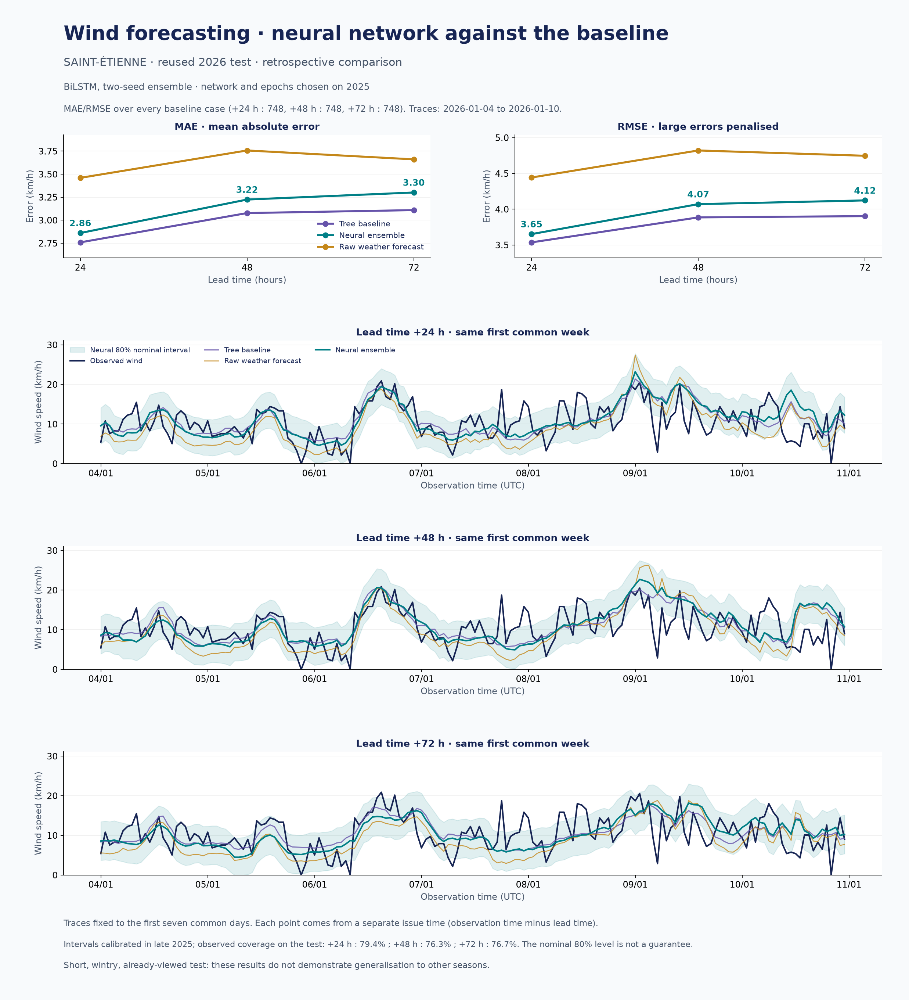
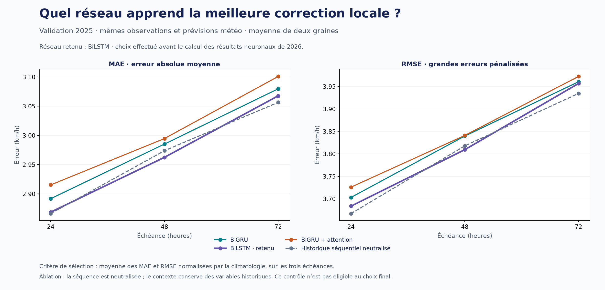
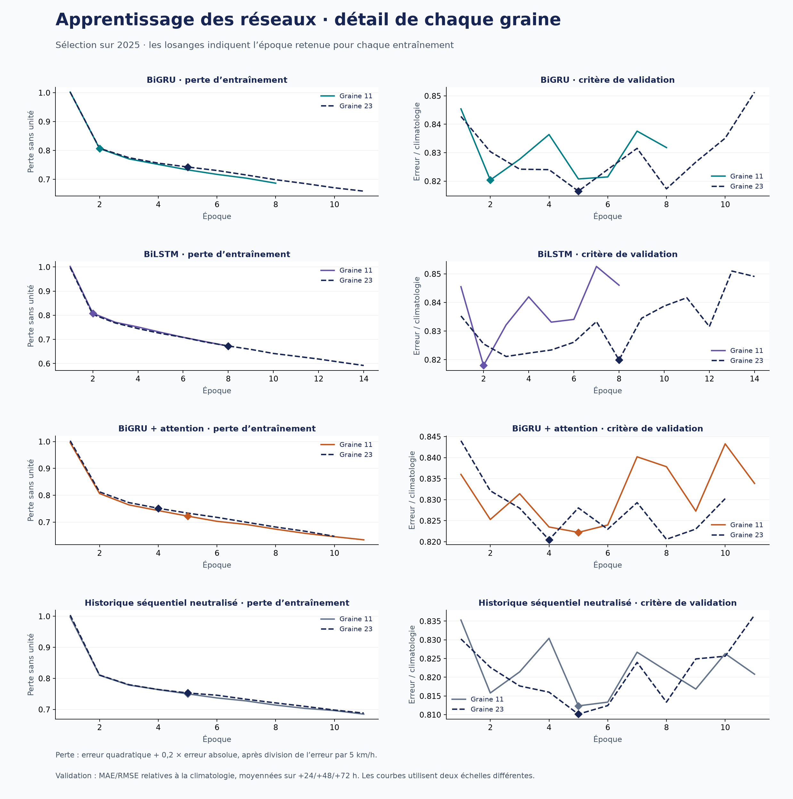

# Résultat neuronal : BiLSTM face à la baseline météo

## Résultat principal

**L'objectif de battre les arbres n'est pas atteint par cette expérience.** Le meilleur candidat récurrent sur validation 2025 est un ensemble de deux BiLSTM. Sur les mêmes 748 cibles par échéance en janvier–février 2026, il dégrade la MAE et la RMSE par rapport aux arbres. Il reste meilleur que la moyenne brute des quatre modèles météo. Les scripts, poids locaux, essais négatifs et graphiques sont conservés.

Il s'agit d'une **comparaison rétrospective sur un test déjà consulté** pendant le travail précédent. Ces chiffres ne constituent ni un nouveau test indépendant ni une garantie opérationnelle annuelle. Aucun réglage neuronal n'a été réalisé après leur lecture.

| Échéance | Arbres MAE / RMSE | BiLSTM MAE / RMSE | Météo brute MAE / RMSE | Hausse de MAE vs arbres |
| --- | ---: | ---: | ---: | ---: |
| +24 h | 2.758 / 3.536 | 2.860 / 3.651 | 3.460 / 4.443 | +3.7 % |
| +48 h | 3.077 / 3.885 | 3.224 / 4.070 | 3.757 / 4.820 | +4.8 % |
| +72 h | 3.109 / 3.903 | 3.300 / 4.123 | 3.660 / 4.746 | +6.2 % |

Toutes les erreurs sont en **km/h**. Le BiLSTM réduit la MAE de la météo brute de 17.3 %, 14.2 % et 9.8 % à +24/+48/+72 h. La baseline à arbres reste la référence de performance ; le BiLSTM est le modèle neuronal principal pour cette expérience.



Les traces utilisent les sept premiers jours communs du test, fixés sans sélectionner un épisode favorable. Chaque courbe correspond à des émissions successives à horizon constant, et non à une unique prévision de sept jours.

## Expérience enregistrée avant les entraînements

La baseline a été commitée sous `e2376b6`, le [protocole](PROTOCOLE.md) sous `d8e5bcb`, puis la sélection neuronale sous `e0b939c`, avant le réentraînement et l'évaluation 2026. Les petites tables de prévisions versionnées figent désormais aussi les valeurs individuelles des comparaisons.

L'architecture utilise 72 h de mesures, des erreurs météo passées déjà vérifiées et les bulletins ECMWF, ICON Global, ICON Europe et GFS. Elle prévoit directement la vitesse à +24/+48/+72 h, sans récursion. Les arbres ne fournissent aucune entrée ni cible neuronale. Les détails, unités, équations et références scientifiques sont dans [ARCHITECTURE.md](ARCHITECTURE.md).

La comparaison est équitable sur les cibles et sur les bulletins disponibles. Le réseau dispose cependant d'une séquence brute et d'erreurs météo supplémentaires ; ce n'est pas une expérience isolant uniquement le remplacement d'un arbre par une cellule RNN. La marge de disponibilité NWP de 24 h reste commune aux deux méthodes.

- Apprentissage initial : **7 895 émissions**, toutes les cibles antérieures au 1er janvier 2025.
- Validation : **6 479 émissions**, dont 6 478 cibles valides à chaque horizon ; émissions à partir du 1er janvier, dernière cible avant le 1er octobre 2025.
- Réentraînement : **14 446 émissions**, toutes les cibles antérieures au 1er octobre 2025.
- Calibration : émissions à partir du 1er octobre, dernière cible avant le 1er janvier 2026.
- Comparaison : **748 cibles identiques par horizon**, du 4 janvier au 4 février 2026 à 03:00 UTC ; l'union des émissions requises compte 796 heures.

Les frontières à +72 h purgent les trois cibles ensemble. Elles diffèrent légèrement des fenêtres de validation/calibration des arbres, dont les modèles étaient entraînés séparément par horizon. Les périodes de test restent exactement alignées.

Les observations remontent à 2020, mais l'apprentissage conjoint avec les quatre archives météo ne dispose que d'environ onze mois avant 2025, leur couverture commune commençant en février 2024. Des milliers de fenêtres horaires recouvrantes ne représentent pas des milliers d'épisodes météo indépendants.

## Comparaison des réseaux sur 2025

| Candidat | +24 h MAE / RMSE | +48 h MAE / RMSE | +72 h MAE / RMSE | Critère normalisé ↓ | Paramètres/réseau |
| --- | ---: | ---: | ---: | ---: | ---: |
| bigru | 2.892 / 3.703 | 2.985 / 3.840 | 3.080 / 3.960 | 0.81439 | 50 681 |
| bilstm | 2.869 / 3.684 | 2.962 / 3.809 | 3.068 / 3.957 | 0.80987 | 60 185 |
| bigru_attention | 2.915 / 3.726 | 2.995 / 3.841 | 3.101 / 3.972 | 0.81813 | 62 825 |
| history_ablation | 2.866 / 3.667 | 2.974 / 3.818 | 3.057 / 3.934 | 0.80871 | 50 681 |

Chaque ligne moyenne les prédictions des graines 11 et 23. Le critère est la moyenne, sur les horizons, de `0,5 × MAE / MAE_climatologie + 0,5 × RMSE / RMSE_climatologie`.

Le BiLSTM est le meilleur **candidat récurrent éligible**, avec les époques **2 et 8** retenues respectivement pour les graines 11 et 23. Le contrôle sans séquence obtient même un critère légèrement meilleur ; il était exclu du choix principal dès le protocole puisque le projet exige un encodeur récurrent exploité. Ce constat ne démontre pas l'intérêt de la séquence supplémentaire dans la configuration actuelle.

Le contrôle conserve des retards et agrégats d'observations dans le contexte dense. Neutraliser la séquence retire à la fois les mesures horaires brutes et les erreurs météo récentes : on ne peut pas attribuer séparément leurs effets. L'attention n'apporte pas d'amélioration ici. Un GRU n'est donc pas « nul » : l'écart avec le LSTM est faible et le choix de cellule ne résout pas, à lui seul, la limite observée.




Huit entraînements initiaux ont été effectués, puis deux réentraînements du BiLSTM, avec arrêt anticipé uniquement pendant la sélection. Durées cumulées des boucles d'apprentissage : **48.8 s** pour la sélection et **7.6 s** pour le réentraînement sur **NVIDIA GeForce GTX 1650 with Max-Q Design** ; lecture des données, initialisation et installation exclues. Chaque BiLSTM contient **60 185 paramètres**, soit deux réseaux distincts moyennés.

## Vents élevés et incertitude

Le seuil est le 90e percentile de toutes les observations FF antérieures au 1er octobre 2025, et non uniquement des exemples disposant de bulletins pour le réentraînement neuronal : **16,56 km/h**, avec seulement **41 heures** concernées dans le test. Ce seuil relatif à la station n'est pas un seuil de tempête et ne désigne pas les rafales. Ces heures peuvent appartenir au même épisode.

| Échéance | MAE vents élevés BiLSTM / arbres | Biais BiLSTM vents élevés | Couverture intervalle nominal 80 % | Largeur moyenne km/h |
| --- | ---: | ---: | ---: | ---: |
| +24 h | 4.46 / 4.66 | -3.78 | 79.4 % | 9.08 |
| +48 h | 5.00 / 4.44 | -4.18 | 76.3 % | 9.46 |
| +72 h | 5.26 / 5.38 | -5.10 | 76.7 % | 9.74 |

Le biais négatif sur ces vents indique que les pointes restent sous-estimées, malgré un biais global positif. Le score moyen ne suffit donc pas à conclure à une bonne prévision des épisodes venteux.

Les intervalles sont calibrés sur les résidus absolus d'octobre–décembre 2025. Leur couverture mesurée à +48/+72 h est inférieure à 80 %. Une garantie conformelle classique ne s'applique pas automatiquement à des séries dépendantes ou changeantes. Le bootstrap des gains stocké dans `metrics.json` utilise seulement cinq blocs d'environ une semaine d'observations scorées ; ses intervalles sont descriptifs et fragiles, pas une démonstration de généralisation annuelle.

## Reproduction et artefacts

Python **3.12.3**, PyTorch **2.8.0+cu126**, NumPy **2.5.3**. Les versions installées figurent dans [environment-linux.txt](environment-linux.txt). C'est un relevé de l'environnement Linux CUDA ; l'index officiel PyTorch est nécessaire pour retrouver le suffixe `+cu126`.

```bash
# Après installation et récupération des données décrites dans le README
python analysis/train_wind_neural.py --phase select
python analysis/train_wind_neural.py --phase refit
python analysis/train_wind_neural.py --phase evaluate
python analysis/plot_wind_neural.py
python -m unittest discover -s tests -v
python analysis/train_wind_neural.py --predict-at 2026-02-01T00:00:00Z
```

`--phase all` exécute les trois étapes dans cet ordre. Relancer les commandes remplace les artefacts de l'expérience dans ce dossier : conserver une copie pour une nouvelle étude. La commande de prédiction est un **rejeu historique sur les archives présentes**, pas un service météo en direct.

`run_config.json` contient les empreintes SHA-256 des données sources, des archives utilisées, du protocole et des modules d'apprentissage. `selection.json` conserve tous les candidats et les époques figées. Les fichiers `history_*.json` et `refit_history.json` décrivent les entraînements ; `metrics.json` et `predictions_*h.csv` permettent de recalculer les résultats.

Les poids, normalisations et grandes archives restent locaux et ignorés par Git : `checkpoints/refit_bilstm_11.pt`, `checkpoints/refit_bilstm_23.pt`, `refit_preprocessing.joblib`. Les configurations des réseaux sont incluses dans les checkpoints. Le rejeu dépend aussi de la sélection et des rayons de calibration enregistrés. [Exemple daté réel](exemple_prevision.json).

**32 tests passent.** Le rejeu réel du 1er février 2026 correspond aux prévisions enregistrées aux trois horizons à moins de 0,0001 km/h. `verification.json` conserve ce contrôle et les empreintes des artefacts finaux, y compris les poids locaux.

Les tests vérifient la causalité, les frontières temporelles, les unités, les masques de cibles, la lecture bidirectionnelle, les gradients, la restauration des poids et l'indépendance des sorties par horizon. Un test modifie fortement des cibles masquées et vérifie que les poids appris ne changent pas.

## Suite proposée pour le projet d'ingénieur

1. **Obtenir une évaluation indépendante couvrant plusieurs saisons**, sur des dates non utilisées pour décider des changements. Réserver ces dates avant tout nouveau réglage ; développer avec une validation chronologique glissante.
2. **Améliorer l'information météo disponible** : archiver les bulletins réellement publiés avec leurs heures de disponibilité, viser des prévisions régionales à maille plus fine et des cellules voisines. Les essais historiques AROME/ARPEGE effectués ici n'ont pas fourni de couverture exploitable ; leur ajout n'est pas réalisé.
3. **Apprendre sur plusieurs stations et davantage d'années de bulletins**, puis adapter le réseau à Saint-Étienne. Tester séparément séquence brute, erreurs récentes, voisinage spatial et type de cellule ; comparer un contexte dense sans RNN à budget identique.
4. **Étendre les objectifs après validation du socle** : composantes du vent, rafales distinctes, quantiles et scores probabilistes. Une pénalisation des vents élevés peut modifier le compromis MAE/RMSE ; elle doit être choisie sur validation, pas pour améliorer artificiellement le mois 2026.

Le livrable actuel est un pipeline neuronal entraîné et reproductible avec un résultat négatif documenté face à une baseline solide. Aucune supériorité « ultra performante » n'est démontrée.

## Journal des commits de l'expérience

| Commit | Étape |
| --- | --- |
| `e2376b6` | Baseline météo et arbres figée |
| `d8e5bcb` | Protocole neuronal avant entraînement |
| `e3c04fe` | Séquences horaires causales et tests |
| `b2cb770` | Réseaux BiGRU, BiLSTM, attention et architecture documentée |
| `47606ab` | Sélection, réentraînement, calibration et rejeu |
| `ebd3f57` | Versions de dépendances portables |
| `e0b939c` | Huit essais 2025 et choix BiLSTM figé |
| `7998a85` | Tests d'entraînement masqué et restauration |
| `4f0cb78` | Cas individuels de la baseline versionnés |
| `01b975c` | Résultats neuronaux 2026 et exemple réel |
| `79d7342` | Génération et export des graphiques |

Le présent rapport, le README et la vérification finale sont enregistrés dans le commit de documentation suivant ces étapes.
